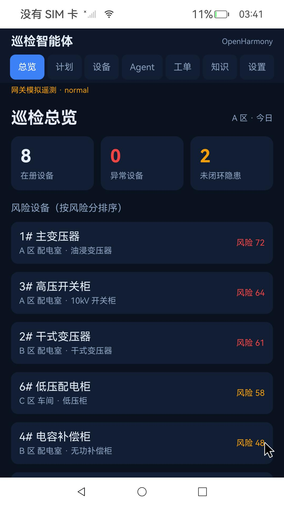

# OpenHarmony 6.0 · RK3588 (Orange Pi 5 Plus) System Image and Board Patches

[中文](README.md) | English

A flashable OpenHarmony 6.0-Release base image for RK3588, plus two patches verified on real hardware: **full-device portrait orientation** and the **ArkWeb renderer fix**.

- Base system: OpenHarmony 6.0-Release, arm64, product `opi5plus`
- Base image built: 2026-11-06 19:27
- Patches verified on device: 2026-11-07
- Hardware: Orange Pi 5 Plus (RK3588), SD-card boot, HDMI output
- License: Apache-2.0 for original work; third-party components as described in [NOTICE.md](NOTICE.md)



> **Read this first:** the released `update.img` is the 2026-11-06 **base image** and does **not** include the portrait or ArkWeb fixes. Apply them after flashing, following [docs/02-apply-patches.md](docs/02-apply-patches.md); the result matches the demo device. The full image has not been repacked, for the reasons in [docs/06-known-issues.md](docs/06-known-issues.md).

## What the two patches fix

### 1. Full-device portrait (1080×1920)

HDMI keeps the panel's native 1920×1080 timing; the display and window stack rotates the whole UI to 1080×1920:

- `buildInDefaultOrientation=1` sets the default orientation;
- `libdms` explicitly issues `RSDisplayNode::SetScreenRotation` at boot and on orientation changes;
- `librender_service` applies the logical-display matrix during composition so portrait surfaces are not clipped by the landscape canvas, and applies its inverse when capturing screenshots;
- `libwms` exposes logical 1080×1920 coordinates to MMI via `persist.window.logical_pointer=true`, so mouse direction and range are correct;
- hardware composition stays enabled; no screen-correction experiments are used.

### 2. ArkWeb renderer (white screen)

`/proc/config.gz` on the board showed `CONFIG_NET_NS=y` but `CONFIG_PID_NS` disabled. `nwebspawn` creates PID + NET namespaces with `sandboxNsFlags=0x60000000`; without `CONFIG_PID_NS` the call fails with `errno=22`, the renderer reports `pid=0`, and the page stays white.

The fix enables `CONFIG_PID_NS` and rebuilds the kernel, **keeping ArkWeb's namespace isolation**. Only `/extlinux/Image` is replaced inside the boot partition; `extlinux.conf` and `toybrick.dtb` are preserved, and the four matching rtw89 Wi-Fi modules are updated.

## Quick start

1. Download the release assets and put `boot.*`, `modules.*` and `*.part*` into `dist-assets/`.
2. Join the split image and verify:
   - Windows: `.\scripts\join-parts.ps1`
   - Linux/macOS: `./scripts/join-parts.sh`
   - Expected SHA-256: `8994286e12c2b8a05aafd9479026fffafc34112ff47ddc199fe0cf5725f38d34`
3. Write `update.img` to an SD card with Rockchip `SDDiskTool`. See [docs/01-flash.md](docs/01-flash.md).
4. Boot the board, connect over `hdc`, and apply the portrait and ArkWeb patches. See [docs/02-apply-patches.md](docs/02-apply-patches.md).
5. Verify with [docs/03-verify.md](docs/03-verify.md); roll back with [docs/04-rollback.md](docs/04-rollback.md).

## Release assets

The image is split into two files below the 2 GB GitHub per-file limit. Join them before flashing.

| File | Bytes | SHA-256 |
| --- | ---: | --- |
| `oh6-opi5plus-20261106.img.part1` | 1,992,294,400 | `6be4ef20ce49e200a75f60d4137b990b288afb314f8d1ff496d40a964b6f1cc9` |
| `oh6-opi5plus-20261106.img.part2` | 1,560,005,194 | `8fe4b01acd797ac75abb8b6ab407f9bacbdefce617ef2a4109496c63ea0c6ef1` |
| `boot.fixed.img` (CONFIG_PID_NS kernel) | 100,663,296 | `35aad4fbf8625e844415f59073e4d1dbd4b59bf7b25298c127ba5c0fec6e6182` |
| `boot.original.img` (original boot partition) | 100,663,296 | `5265214bd47329f5e6ab43290c86e4df3999bc875aff9f7c819aaa99d83e8e3c` |
| `modules.fixed.tar` (4 rtw89 modules) | 1,105,920 | `56f5210a9d953adffe1065f525c765a435569f7b0a0d3575c97cda148c29df52` |
| `modules.original.tar` (original modules) | 1,094,144 | `96379c22e6645ecf0a26c5a2f2b36dbff8c41f2ae569334093e4595f51fe3749` |

After joining, the image must be 3,552,299,594 bytes with SHA-256 `8994286e…f38d34`.

## Repository layout

```
docs/      flashing, patch, verification, rollback and build notes (Chinese)
patches/   portrait libraries and originals, display config, modified sources;
           ArkWeb kernel build/pack scripts and the namespace probe
scripts/   on-device install/rollback/verify scripts, join and checksum helpers
records/   original 2026-11-07 repair records (Chinese)
checksums/ asset checksums
```

`dist-assets/` is not tracked by Git; it is where downloaded release assets go.

## Verification scope

Verified on hardware: portrait display and screenshots, mouse direction and range, `CONFIG_PID_NS=y`, namespace child process PID=1, ArkWeb local HTML/JS and HTTP/HTTPS pages, patches surviving reboot, and the app launching after a hot install. Readouts and screenshots are in [docs/03-verify.md](docs/03-verify.md) and [`records/`](records/).

Not verified: repacking the full image, a separate Wi-Fi connectivity retest after the kernel swap, touch input, or other boards/panels.

The detailed docs are written in Chinese; all commands and file paths are language-independent. English translations can be added on request.

## Relationship to the application

This repository contains only the **system image and board patches**. The inspection-agent application, gateway and demo data are installed separately via `hdc install`.

## Disclaimer

Flashing and replacing system partitions carry risk; confirm your hardware model and back up your data first. This is an unofficial adaptation provided as-is, without warranty of any kind.
