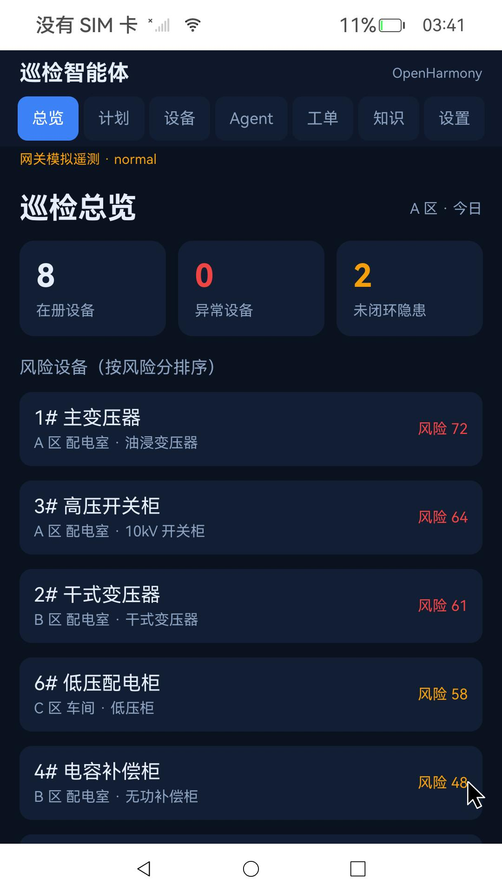

# OpenHarmony 6.0 · RK3588（Orange Pi 5 Plus）系统镜像与板级补丁

中文 | [English](README.en.md)

面向「巡检智能体」作品的 RK3588 板级系统适配：一份可刷入的 OpenHarmony 6.0-Release 基础镜像，加上两项在实机验证过的系统补丁——**整机竖屏**与 **ArkWeb 渲染进程修复**。

- 基础系统：OpenHarmony 6.0-Release，arm64，产品 `opi5plus`
- 基础镜像打包：2026-11-06 19:27
- 补丁上板验证：2026-11-07
- 适用硬件：Orange Pi 5 Plus（RK3588），SD 卡启动，HDMI 输出
- 许可：自有部分 Apache-2.0；镜像内的第三方组件见 [NOTICE](NOTICE.md)



> **先读这一段**：发布的 `update.img` 是 2026-11-06 的**基础镜像**，不包含竖屏与 ArkWeb 修复。修复以补丁形式提供，刷机后按 [02 · 应用系统补丁](docs/02-apply-patches.md) 应用；应用后的状态与演示机一致。整镜像尚未重新打包，原因见 [06 · 已知限制](docs/06-known-issues.md)。

## 两个补丁解决什么

### 1. 整机竖屏（1080×1920）

HDMI 仍输出面板原生的 1920×1080 时序，由显示与窗口服务把整机旋转为 1080×1920：

- `buildInDefaultOrientation=1` 设置默认方向；
- `libdms` 在启动和方向变化时显式下发 `RSDisplayNode::SetScreenRotation`；
- `librender_service` 在逻辑屏幕合成时补上显示矩阵，避免竖屏窗口被横屏画布裁切；截图时合入逆矩阵；
- `libwms` 通过 `persist.window.logical_pointer=true` 向 MMI 提供逻辑 1080×1920 坐标，鼠标方向与范围正确；
- 未关闭硬件合成，也未使用 screen correction 之类的试验开关。

### 2. ArkWeb 渲染进程（白屏修复）

板端 `/proc/config.gz` 显示 `CONFIG_NET_NS=y` 但 `CONFIG_PID_NS` 未启用。`nwebspawn` 用 `sandboxNsFlags=0x60000000` 创建 PID + NET 命名空间时返回 `errno=22`，渲染进程 `pid=0`，页面白屏。

修复方式是启用 `CONFIG_PID_NS` 并重编内核，**保留 ArkWeb 的命名空间隔离**；启动分区只替换 `/extlinux/Image`，保留 `extlinux.conf` 与 `toybrick.dtb`，同时更新匹配的 4 个 rtw89 Wi-Fi 模块。

## 快速开始

1. 下载 Release 资产，把其中的 `boot.*`、`modules.*`、`*.part*` 放进仓库的 `dist-assets/` 目录。
2. 合并分卷并校验：
   - Windows：`.\scripts\join-parts.ps1`
   - Linux/macOS：`./scripts/join-parts.sh`
   - 期望 SHA-256：`8994286e12c2b8a05aafd9479026fffafc34112ff47ddc199fe0cf5725f38d34`
3. 用 Rockchip `SDDiskTool` 把 `update.img` 写入 SD 卡，详见 [01 · 刷入基础镜像](docs/01-flash.md)。
4. 启动后通过 `hdc` 应用竖屏补丁与 ArkWeb 补丁，详见 [02 · 应用系统补丁](docs/02-apply-patches.md)。
5. 按 [03 · 验收](docs/03-verify.md) 检查；需要撤销时看 [04 · 回退](docs/04-rollback.md)。

## 发布文件

镜像被拆成两个小于 2 GB 的分卷（GitHub 单文件限制），先合并再刷写。

| 文件 | 字节 | SHA-256 |
| --- | ---: | --- |
| `oh6-opi5plus-20261106.img.part1` | 1,992,294,400 | `6be4ef20ce49e200a75f60d4137b990b288afb314f8d1ff496d40a964b6f1cc9` |
| `oh6-opi5plus-20261106.img.part2` | 1,560,005,194 | `8fe4b01acd797ac75abb8b6ab407f9bacbdefce617ef2a4109496c63ea0c6ef1` |
| `boot.fixed.img`（CONFIG_PID_NS 内核） | 100,663,296 | `35aad4fbf8625e844415f59073e4d1dbd4b59bf7b25298c127ba5c0fec6e6182` |
| `boot.original.img`（原始启动分区） | 100,663,296 | `5265214bd47329f5e6ab43290c86e4df3999bc875aff9f7c819aaa99d83e8e3c` |
| `modules.fixed.tar`（4 个 rtw89 模块） | 1,105,920 | `56f5210a9d953adffe1065f525c765a435569f7b0a0d3575c97cda148c29df52` |
| `modules.original.tar`（原始模块） | 1,094,144 | `96379c22e6645ecf0a26c5a2f2b36dbff8c41f2ae569334093e4595f51fe3749` |

分卷合并后总大小 3,552,299,594 字节，SHA-256 必须为 `8994286e…f38d34`。

## 仓库结构

```
docs/      刷机、补丁、验收、回退、构建说明
patches/   竖屏 .so 与原始件、显示配置、修改源码
           ArkWeb 内核构建/打包脚本、命名空间探针
scripts/   设备端安装/回退/验收脚本，分卷合并与校验
records/   2026-11-07 的原始修复记录
checksums/ 资产校验清单
```

`dist-assets/` 不在 Git 里，用于放置从 Release 下载的二进制资产。

## 验证范围

已在上板实机验证：竖屏显示与截图、鼠标方向与范围、`CONFIG_PID_NS=y`、命名空间子进程 PID=1、ArkWeb 本地 HTML/JS 与 HTTP/HTTPS 页面、重启后补丁仍生效、应用热安装后启动正常。详细读数与截图见 [docs/03-verify.md](docs/03-verify.md) 与 [`records/`](records/)。

未验证：整镜像重打包、替换内核后的 Wi-Fi 单独联网复测、触摸输入、其他载板/屏幕。

## 与应用的关系

本仓库只包含**系统镜像与板级补丁**，不包含「巡检智能体」应用源码、网关与演示数据。应用通过 `hdc install` 单独安装。

## 免责声明

刷机与直接替换系统分区有风险，请先确认硬件型号并备份数据。本仓库为非官方适配产物，按“现状”提供，不附带任何明示或暗示担保。
